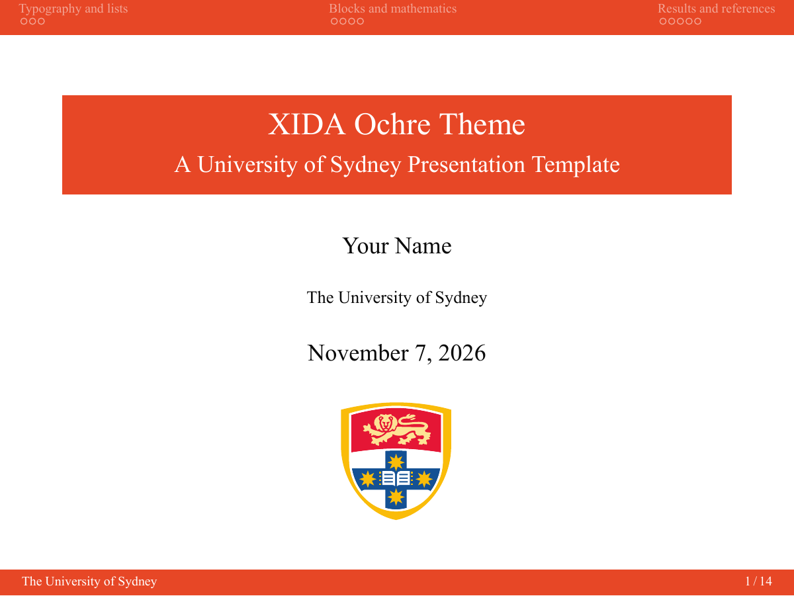
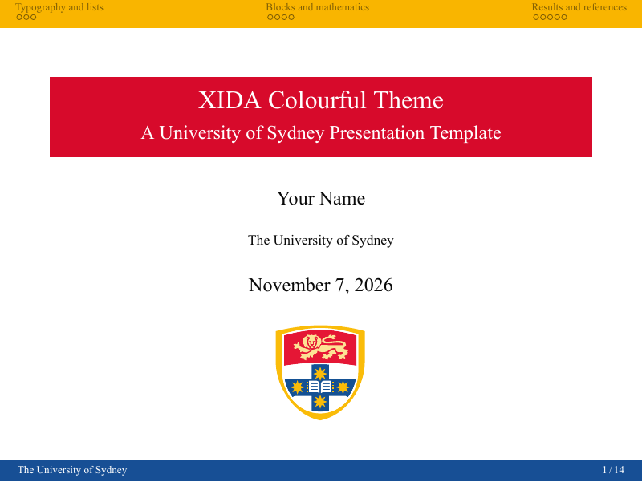
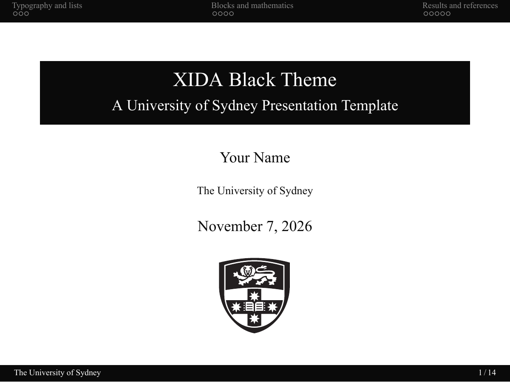

# XIDA Beamer Theme

An unofficial University of Sydney-inspired Beamer theme adapted from [SUDA Beamer Theme](https://github.com/ymliucs/SUDA-Beamer-Theme) by Yumeng Liu, itself based on [THU Beamer Theme](https://www.overleaf.com/latex/templates/thu-beamer-theme/vwnqmzndvwyb).

### Ochre



[View the Ochre example](preview.pdf).

### Colourful



[View the colourful example](preview-colourful.pdf).

### Black



[View the black example](preview-black.pdf).

## Features

- 4:3 slides with flat ochre (`#E74726`) navigation and title bars.
- Times New Roman text, section navigation, and a school name / page number footer.
- Examples of lists, blocks, mathematics, theorems, tables, and references.

## Build

Install a TeX distribution with XeLaTeX and install Times New Roman separately. Run `xelatex main.tex` twice. Edit `main.tex` to make your presentation. For a new presentation copy `xida.sty` and `figs/` and use:

```latex
\documentclass[aspectratio=43]{beamer}
\usepackage{xida}
```

For the colourful or black variant, copy `xida.sty` and the corresponding variant file, and replace the package line with `\usepackage{xida-colourful}` or `\usepackage{xida-black}`. Build `example-colourful.tex` or `example-black.tex` to see the complete examples.

Text uses Times New Roman; mathematical symbols use the available TeX math fonts.

## Colours

| Name | Hex |
| --- | --- |
| `ochre` | `#E74726` |
| `MasterbrandBlack` | `#0A0A0A` |
| `MasterbrandCharcoal` | `#424242` |
| `MasterbrandWhite` | `#FFFFFF` |
| `ShieldRed` (colourful) | `#D70A2B` |
| `ShieldGold` (colourful) | `#F9B500` |
| `ShieldBlue` (colourful) | `#174F95` |

## Attribution and branding

The source SUDA template is published on [Overleaf](https://www.overleaf.com/latex/templates/suda-beamer-theme/zrrdkvxkktjr) under CC BY 4.0. This adaptation credits its author and records its changes above. The theme and original example content in this repository are shared under [CC BY 4.0](https://creativecommons.org/licenses/by/4.0/), excluding third-party trademarks and assets. The shield is cropped from a vector logo available in a local University of Sydney thesis template. University names and logos remain the property of their respective owners; their use is subject to applicable branding rules. This project is not affiliated with or endorsed by the University of Sydney.
